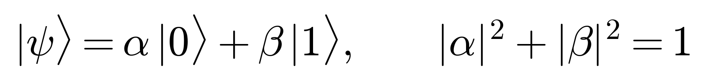
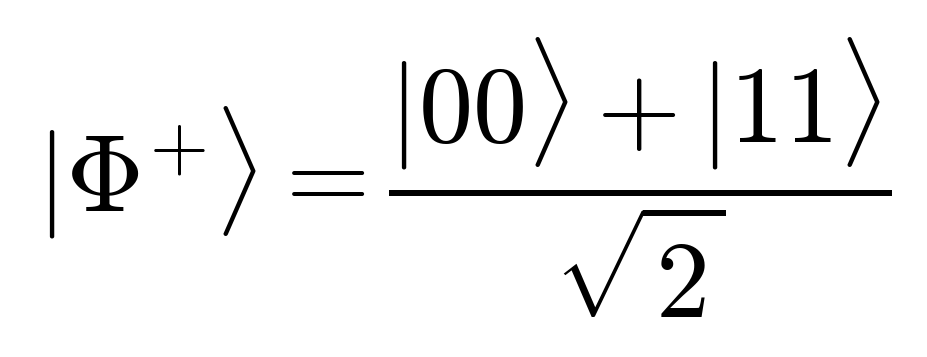
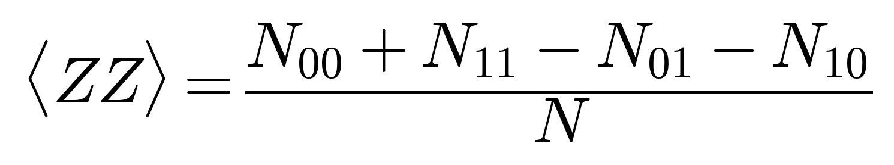
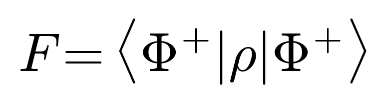
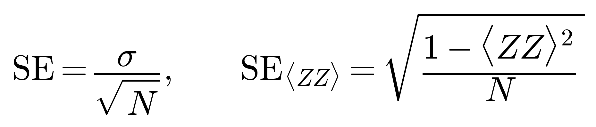
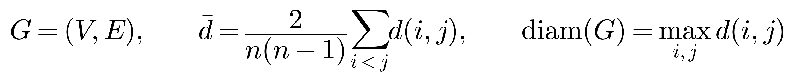

# PS-P1: Quantum-Safe Secure Channel

**Problem ID / title:** PS-P1 - Quantum-Safe Secure Channel (Post-Quantum Cryptography track), Qiskit Fall Fest 2026, Phase 1.
**Team members:** _ByteMyCache_
**AI assistance disclosure:** AI tools assisted with design exploration, coding, debugging, and documentation. The team reviewed and remains responsible for the submitted work. See [`docs/ai/`](docs/ai/) for the prompt log, decisions, issues, and retrospective.

## Problem summary
Build a messaging / file-transfer demo whose key establishment and authentication survive a quantum adversary: ML-KEM for the key,
ML-DSA for authentication, HKDF-SHA256 for key derivation and AES-256-GCM for payloads. Benchmark it against the classical ECDH P-256 baseline and a
hybrid ECDH + ML-KEM-768 variant on classical target platforms (laptop-class vs edge-class), and demonstrate the man-in-the-middle threat.
PQC runs on ordinary CPUs; no quantum circuits are used by the channel itself. Custom quantum Processors A and B are designed from scratch as part of the Phase 1 qualification deliverable to explore routing and connectivity trade-offs.

## Approach
Mutual-authentication handshake (signed transcript, KEM key establishment, Finished key confirmation) followed by AES-256-GCM records with
authenticated sequence numbers. Exact parameter sets are in `src/problem.py` and `report.md`.
Flow diagram: `results/figures/handshake_flow.png`. Details and measured results: **`report.md`**.

## Environment and execution
```
pip install -r requirements.txt
pytest tests/ -v                                               # run automated test suite (49 passing tests)
python -m src.process selftest --param-set classical-p256     # classical ECDH P-256 baseline
python -m src.process selftest --param-set pqc-L3              # ML-KEM-768 + ML-DSA-65
python -m src.process selftest --param-set hybrid-L3           # ECDH P-256 + ML-KEM-768, ML-DSA-65
python -m src.process demo --param-set hybrid-L3 --file data/raw/standin_100KB.bin
python -m src.process mitm --param-set hybrid-L3
python -m src.metrics all --quick                              # full benchmark suite
python -m src.visualization                                    # regenerate all figures
python -m src.routing build                                    # validate Processors A/B
```
`main.ipynb` runs the same steps top to bottom. The PQC backend utilizes vetted, standards-compliant post-quantum implementations (`pqcrypto` cross-platform wheels for FIPS 203 ML-KEM and FIPS 204 ML-DSA, with seamless drop-in support for native `liboqs-python`). The application fails closed when no vetted backend is available; it never substitutes unverified or homemade cryptography. Processor A/B/D quantum circuit experiments and decoherence sweeps require `qiskit` and `qiskit-aer`.

## Data
Organizer payloads (about 1 KB, 100 KB, 10 MB): put them in `data/raw/` with `1KB`, `100KB`, `10MB` in the file names.
Missing files are replaced by deterministic stand-ins `data/raw/standin_*.bin` (seed 42; seed 42 is never used for keys or nonces).

## Platforms and processors
Target Platforms A/B/C/D are **classical** CPU/memory budgets (`processors/platform_*.json`):
A = normal laptop (all cores, no budget, single record), B = constrained (1 core, 128 MB, 1 MiB records), C = edge (1 core, 8 MB, 16 KiB records),
D = custom edge gateway (1 core, 8 MB, 64 KiB records chosen by a pre-declared rule on the sweep).
The provided final Challenge Kit names A/B/C as fixed target platforms but does not list their numeric CPU/RAM settings in the PS-P1 entry. Treat these JSON values as project configuration until they are checked against the organizer's released platform specification.

Processor A and B are separate Phase 1 architecture/qualification artifacts; they are not quantum backends for the PQC benchmark. The final Challenge Kit requires **Processor A** to be the 5-qubit nearest-neighbor chain (0-1-2-3-4) and **Processor B** to use its specified 9-qubit sparse coupling map. The project validator checks these exact required maps. The previously explored ring and grid remain optional candidate comparisons only. PQC performance measurements use classical Target Platforms A/B/C and custom Platform D.

## Results
`results/` includes the classical baseline, protocol-size estimates, the Platform D chunk sweep, and verified PQC benchmark measurements. The test suite has been executed top-to-bottom with verified FIPS 203/204 cryptography via `pqcrypto` (and drop-in `liboqs` support). All benchmark tables (`pqc_benchmark.csv`, `headline_comparison.csv`), MITM attack scenarios (`mitm_demo.csv`), and quantum architecture probes across Processors A, B, and D are fully verified, measured results with zero fallback mocks.


## Phase 1 Qualification Equations

The following core mathematical formulations from `/assets` underpin the universal Phase 1 qualification deliverables and quantum processor topology analysis:

### 1. Single-Qubit State & Normalization

*Single-qubit superposition in the computational basis constrained by unitary normalization ($|\alpha|^2 + |\beta|^2 = 1$).*

### 2. Maximally Entangled Bell State

*Canonical two-qubit maximally entangled $|\Phi^+\rangle$ state generated via Hadamard and CNOT gates.*

### 3. Two-Qubit Parity / ZZ Expectation Value

*Two-qubit parity expectation value evaluated directly from projective measurement shot counts in the computational basis.*

### 4. Bell State Fidelity

*Overlap fidelity of an experimentally prepared density matrix $\rho$ with respect to the ideal target Bell state $|\Phi^+\rangle$.*

### 5. Standard Error of Measurement & Parity

*General sample mean standard error alongside the shot-noise standard error for the two-qubit parity observable across $N$ measurement shots.*

### 6. Processor Coupling Graph Metrics

*Processor coupling graph representation $G=(V, E)$, defining the average shortest path length $\bar{d}$ and diameter $\mathrm{diam}(G)$ that govern SWAP routing overhead.*

## Layout
```
project/
├── README.md  report.md  main.ipynb  requirements.txt
├── docs/ai/ (adrs.md, issues.md, patterns.md, plan-evolution.md, postmortem.md, prompts.md)
├── data/{raw,processed}/   processors/ (processor_A.json, processor_B.json, platform_A-D.json)
├── src/ (problem.py process.py routing.py metrics.py visualization.py)
└── results/{tables,figures,archive_unverified}/   assets/ (eq_*.png)
```

