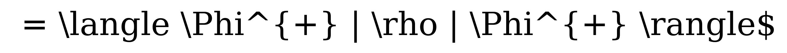

# Bell State Fidelity

## Visual Mathematical Formulation

$$
F = \langle \Phi^{+} | \rho | \Phi^{+} \rangle
$$

## LaTeX Code

```latex
F = \langle \Phi^{+} | \rho | \Phi^{+} \rangle
```

## Rendered Image



## Description & Context
Measures the state fidelity $F \in [0, 1]$ between an ideal pure target Bell state $|\Phi^{+}\rangle$ and the actual density matrix $\rho$ reconstructed or simulated after propagation through noisy quantum hardware channels.

## Qiskit Implementation

```python
from qiskit.quantum_info import state_fidelity, DensityMatrix

def calculate_bell_fidelity(noisy_density_matrix: DensityMatrix, ideal_target: DensityMatrix) -> float:
    """Calculate quantum state fidelity against ideal Bell target."""
    return float(state_fidelity(noisy_density_matrix, ideal_target))
```
