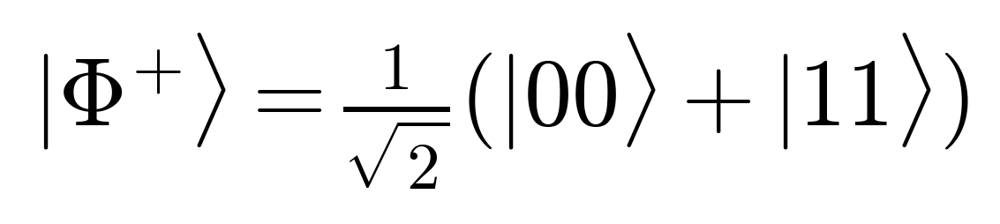

# Bell State $|\Phi^{+}\rangle$

## Visual Mathematical Formulation

$$
|\Phi^{+}\rangle = \frac{1}{\sqrt{2}}(|00\rangle + |11\rangle)
$$

## LaTeX Code

```latex
|\Phi^{+}\rangle = \frac{1}{\sqrt{2}}(|00\rangle + |11\rangle)
```

## Rendered Image



## Description & Context
Represents the canonical maximally entangled two-qubit Bell state $|\Phi^{+}\rangle$. In our quantum-safe secure communication pipeline, Bell pairs form the foundation of entanglement-assisted key distribution and quantum parity verification across untrusted relays.

## Qiskit Implementation

```python
from qiskit import QuantumCircuit

# Generate maximally entangled Bell state |Phi+>
qc = QuantumCircuit(2)
qc.h(0)
qc.cx(0, 1)
```
