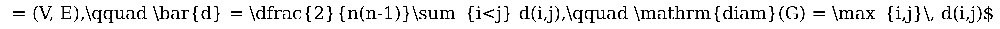

# Processor Coupling Graph Metrics

## Visual Mathematical Formulation

$$
G = (V, E),\qquad \bar{d} = \frac{2}{n(n-1)}\sum_{i \lt j} d(i,j),\qquad \operatorname{diam}(G) = \max_{i,j} d(i,j)
$$

## LaTeX Code

```latex
G = (V, E),\qquad \bar{d} = \frac{2}{n(n-1)}\sum_{i \lt j} d(i,j),\qquad \operatorname{diam}(G) = \max_{i,j} d(i,j)
```

## Rendered Image



## Description & Context
Defines hardware connectivity topology metrics for quantum processor coupling graphs $G=(V, E)$, including average shortest path length $\bar{d}$ and network diameter $\operatorname{diam}(G)$. These metrics directly dictate circuit routing overhead, determining the minimum number of SWAP gates required to entangle non-adjacent physical qubits.

## NetworkX Implementation

```python
import networkx as nx

def calculate_topology_metrics(coupling_graph: nx.Graph) -> dict[str, float]:
    """Calculate average shortest path length and diameter for a coupling graph."""
    return {
        "nodes": coupling_graph.number_of_nodes(),
        "edges": coupling_graph.number_of_edges(),
        "average_shortest_path_length": nx.average_shortest_path_length(coupling_graph),
        "diameter": nx.diameter(coupling_graph),
    }
```
