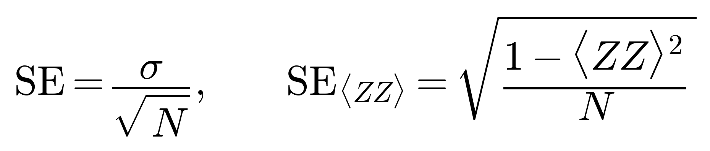

# Standard Error of Measurement & Parity

## Visual Mathematical Formulation

$$
\mathrm{SE} = \frac{\sigma}{\sqrt{N}},\qquad \mathrm{SE}_{\langle ZZ\rangle} = \sqrt{\frac{1 - \langle ZZ \rangle^{2}}{N}}
$$

## LaTeX Code

```latex
\mathrm{SE} = \frac{\sigma}{\sqrt{N}},\qquad \mathrm{SE}_{\langle ZZ\rangle} = \sqrt{\frac{1 - \langle ZZ \rangle^{2}}{N}}
```

## Rendered Image



## Description & Context
Quantifies statistical shot noise across $N$ circuit measurement shots. For general sample observables, standard error scales inversely with the square root of shots ($\sigma / \sqrt{N}$). For parity observables bounded in $[-1, 1]$, the standard error follows binomial shot statistics $\sqrt{(1 - \langle ZZ \rangle^2) / N}$, yielding zero variance when the state is in an eigenstate of the parity operator ($\langle ZZ \rangle = \pm 1$).

## Python Implementation

```python
import numpy as np

def standard_error_zz(zz_expectation: float, shots: int) -> float:
    """Calculate shot-noise standard error for ZZ parity observable."""
    if shots <= 0:
        return 0.0
    variance = max(0.0, 1.0 - (zz_expectation ** 2))
    return float(np.sqrt(variance / shots))
```
