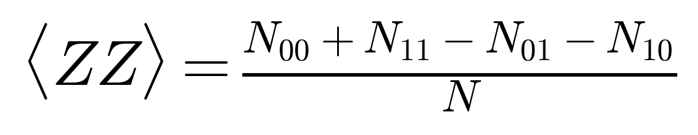

# Parity Expectation Value $\langle ZZ \rangle$

## Visual Mathematical Formulation

$$
\langle ZZ \rangle = \frac{N_{00} + N_{11} - N_{01} - N_{10}}{N}
$$

## LaTeX Code

```latex
\langle ZZ \rangle = \frac{N_{00} + N_{11} - N_{01} - N_{10}}{N}
```

## Rendered Image



## Description & Context
Calculates the parity expectation value along the computational $Z \otimes Z$ basis from measured shot counts. For an ideal, noise-free Bell pair $|\Phi^{+}\rangle$, $\langle ZZ \rangle = +1.0$. Any deviation from $+1.0$ indicates environmental dephasing, gate errors, or eavesdropper interception along the channel.

## Python Implementation

```python
def compute_zz_expectation(counts: dict[str, int]) -> float:
    """Compute parity expectation <ZZ> from execution measurement counts."""
    n00 = counts.get("00", 0)
    n11 = counts.get("11", 0)
    n01 = counts.get("01", 0)
    n10 = counts.get("10", 0)
    total = n00 + n11 + n01 + n10
    if total == 0:
        return 0.0
    return (n00 + n11 - n01 - n10) / total
```
